# Icons

Templates never write an icon class. They render an icon from its **logical name**, which describes what the icon
means, not what it looks like. Arrows and chevrons (except `dropdown`) are the exception: the same drawing serves
many purposes (back, previous page, old value → new value…), so they get a generic name (`back`, `next`, `forward`,
`arrow-up`…). **One drawing has one name**, shared by every place that uses it:

```twig
{{ ui_icon('delete') }}
```

Icons are SVG rendered by [Symfony UX Icons](https://symfony.com/bundles/ux-icons/current/index.html). The project
chooses its **icon library** (`lle_crudit_ui.icons.library`, Font Awesome 7 by default) and the bundle builds the
Iconify name of each logical name from it (`prefix:name`): `delete` is `fa7-solid:trash` with Font Awesome,
`lucide:trash` with Lucide. The table of each library is in [Icon libraries](icon-libraries.md); the catalogue below
shows the Font Awesome one.

The icons chosen by the projects (actions, menu, tabs) are not in the catalogue: the project passes their Iconify
name as is, from any icon set ([ux.symfony.com/icons](https://ux.symfony.com/icons)).

```twig
{{ ui_icon('lucide:truck') }}
```

`lle_crudit_ui.icons.map` replaces any icon by another Iconify name, keyed by logical name for the catalogue and by
Iconify name for the icons passed by the project (see [Configuration](configuration.md#icons)).

An icon that cannot be rendered (unknown name, icon missing from the library, Iconify name that does not exist)
does not break the page: `ui_icon()` renders nothing and logs a warning.

Logical names are in kebab-case (`external-link`, `sort-asc`). **RTL** marks the directional icons: they are
mirrored when the page is right-to-left (`dir="rtl"`), whatever the library: `ui_icon()` gives them the
`crudit-ui-icon--mirror` class.

## Catalogue

The previews are the SVG files of [Font Awesome Free](https://fontawesome.com) 7.3.1 (icons under
[CC BY 4.0](https://creativecommons.org/licenses/by/4.0/)), in grey so that they show on light and dark themes. They
are not mirrored: the RTL column says which icons are.

### Actions

| | Name | Font Awesome 7 (default) | RTL | Used in |
|---|---|---|---|---|
|  | `add` | `fa7-solid:plus` | | Crudit (new, add a filter, collection), mockup |
| 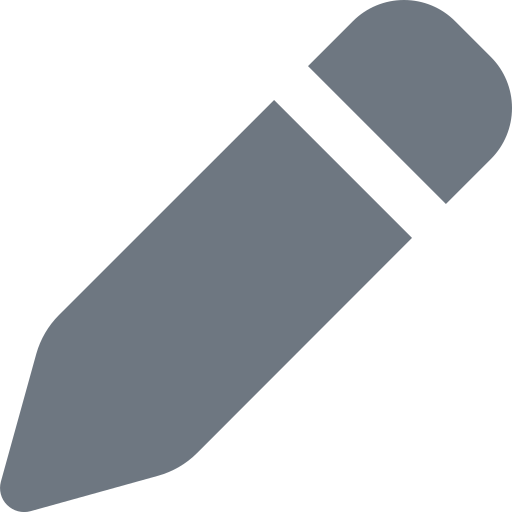 | `edit` | `fa7-solid:pen` | | Crudit (`edit`), mockup |
| 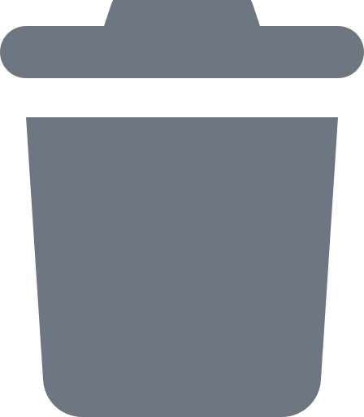 | `delete` | `fa7-solid:trash` | | Crudit (`trash-alt`), mockup |
|  | `remove` | `fa7-solid:minus` | | Crudit (fewer filters) |
| 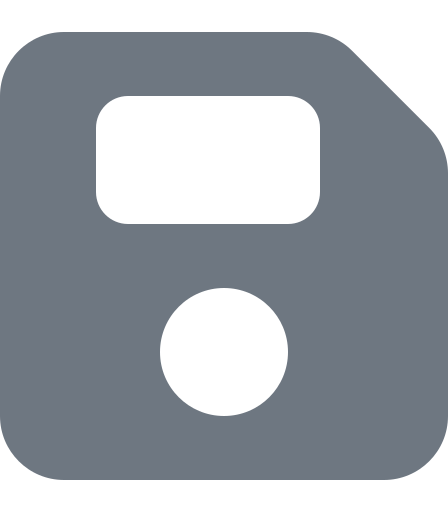 | `save` | `fa7-solid:floppy-disk` | | mockup (form, tab form) |
| 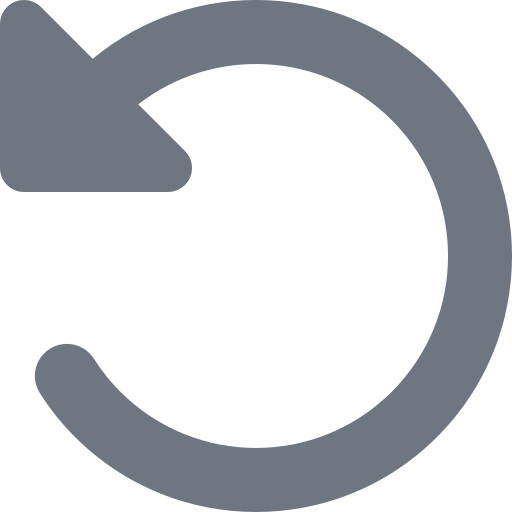 | `undo` | `fa7-solid:rotate-left` | yes | mockup (reset the form) |
| 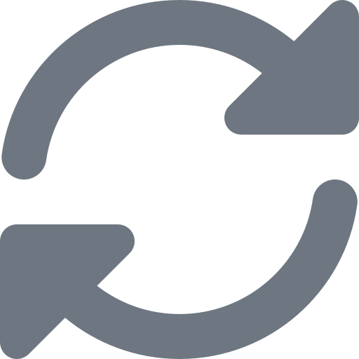 | `refresh` | `fa7-solid:rotate` | | mockup (list, dashboard) |
|  | `resume` | `fa7-solid:play` | | mockup (resume the automatic refresh of a list) |
|  | `close` | `fa7-solid:xmark` | | Crudit (`close`, `window-close`), mockup |
|  | `search` | `fa7-solid:magnifying-glass` | | Crudit (search, show action), mockup |
|  | `filter` | `fa7-solid:filter` | | Crudit, mockup |
|  | `filter-clear` | `fa7-solid:filter-circle-xmark` | | mockup (no result with the current filters) |
| 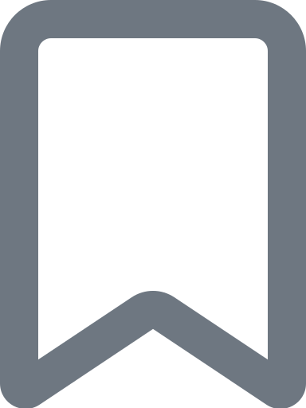 | `bookmark` | `fa7-regular:bookmark` | | mockup (save the filters) |
|  | `bookmark-active` | `fa7-solid:bookmark` | | mockup (saved filters in use) |
| 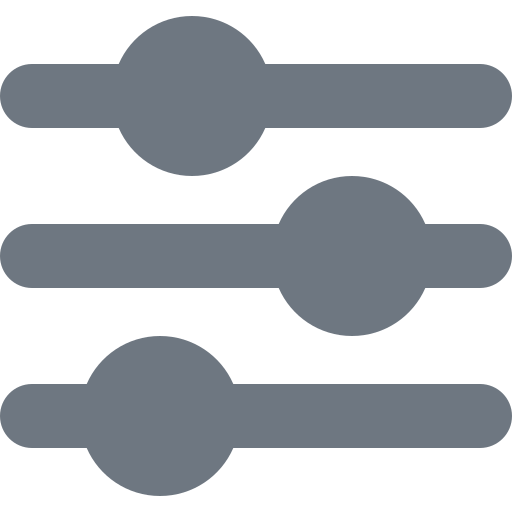 | `settings` | `fa7-solid:sliders` | | mockup (list columns, widget settings) |
|  | `more` | `fa7-solid:ellipsis-vertical` | | Crudit (kebab menu), mockup |
| 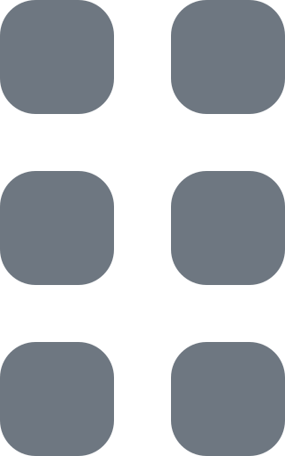 | `drag` | `fa7-solid:grip-vertical` | | Crudit (sortable rows), mockup |
| 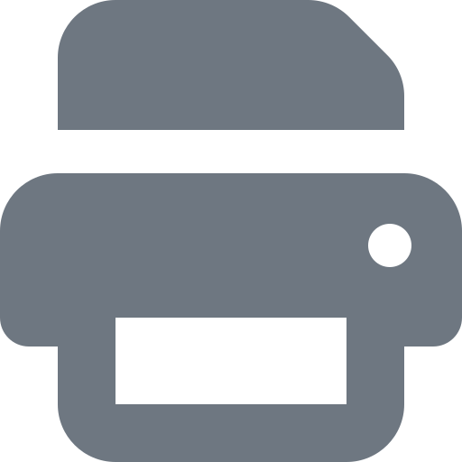 | `print` | `fa7-solid:print` | | mockup |
|  | `copy` | `fa7-solid:copy` | | mockup |
| 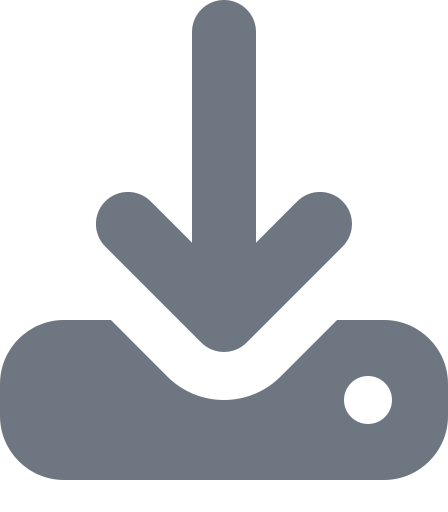 | `download` | `fa7-solid:download` | | Crudit (file widget, `file-export` action), mockup (export, file upload) |
|  | `upload` | `fa7-solid:cloud-arrow-up` | | mockup (file upload, data import widget) |
|  | `send` | `fa7-solid:paper-plane` | yes | mockup |
|  | `link` | `fa7-solid:link` | | mockup (rich text editor) |
|  | `external-link` | `fa7-solid:arrow-up-right-from-square` | yes | Crudit (`external-link-alt`), mockup |

### Navigation

| | Name | Font Awesome 7 (default) | RTL | Used in |
|---|---|---|---|---|
| 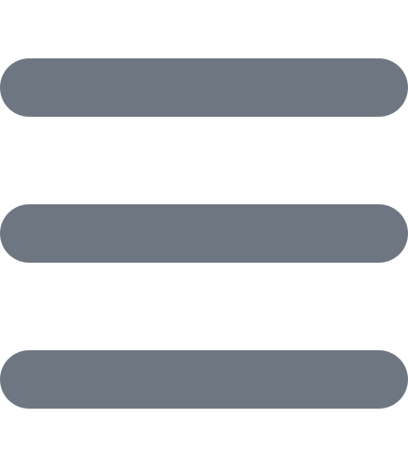 | `menu` | `fa7-solid:bars` | | Crudit, mockup (open the menu) |
|  | `dropdown` | `fa7-solid:chevron-down` | | Crudit (`chevron-down`, `chevron-up`), mockup (menus, sections, history). Rotated with CSS when open |
|  | `forward` | `fa7-solid:chevron-right` | yes | mockup (breadcrumb separator, submenu) |
|  | `sidebar-toggle` | `fa7-solid:angles-left` | yes | mockup (reduce the menu to icons and back). Mirrored with CSS when the menu is reduced |
|  | `first` | `fa7-solid:backward-step` | yes | Crudit (`angle-double-left`), mockup (pagination) |
| 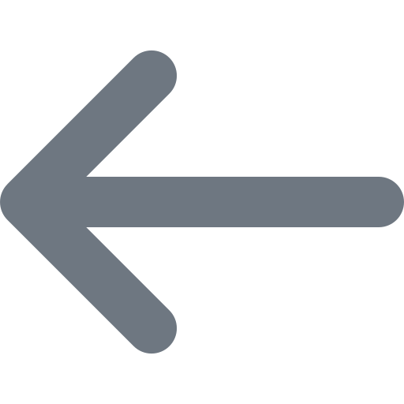 | `back` | `fa7-solid:arrow-left` | yes | Crudit (`arrow-circle-left`, `angle-left`), mockup (breadcrumb, pagination) |
| 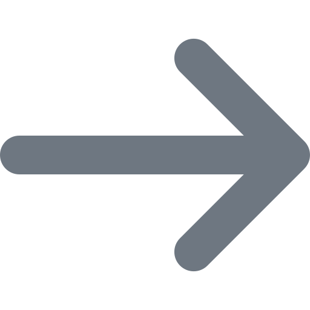 | `next` | `fa7-solid:arrow-right` | yes | Crudit (`angle-right`, history: old value → new value), mockup (pagination, widget link) |
|  | `last` | `fa7-solid:forward-step` | yes | Crudit (`angle-double-right`), mockup (pagination) |
| 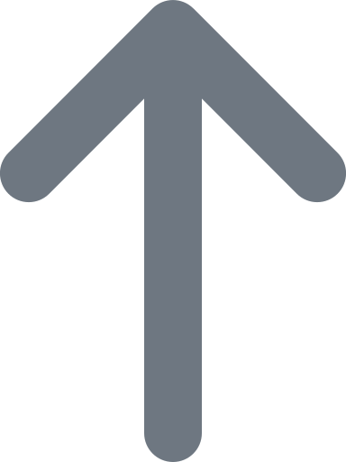 | `arrow-up` | `fa7-solid:arrow-up` | | Crudit (`angle-up`, back to top), mockup (back to top, move up in a collection or cards) |
|  | `arrow-down` | `fa7-solid:arrow-down` | | mockup (move down in a collection or cards) |
| 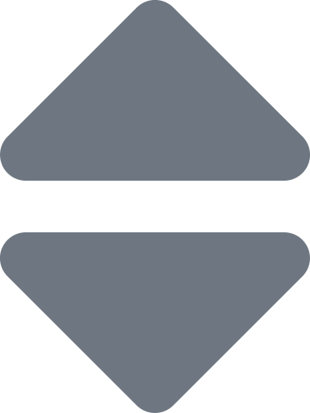 | `sort` | `fa7-solid:sort` | | Crudit, mockup |
| 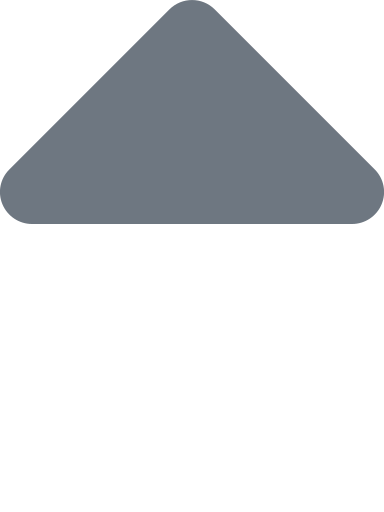 | `sort-asc` | `fa7-solid:sort-up` | | Crudit, mockup |
|  | `sort-desc` | `fa7-solid:sort-down` | | Crudit, mockup |

### Status and feedback

| | Name | Font Awesome 7 (default) | RTL | Used in |
|---|---|---|---|---|
|  | `success` | `fa7-solid:circle-check` | | mockup (toasts) |
|  | `info` | `fa7-solid:circle-info` | | Crudit (`info-circle`, help tooltips), mockup |
|  | `warning` | `fa7-solid:triangle-exclamation` | | Crudit (`exclamation-triangle`), mockup |
|  | `error` | `fa7-solid:circle-exclamation` | | mockup (form errors) |
|  | `check` | `fa7-solid:check` | | Crudit (batch, fields), mockup (selected item, boolean) |
| 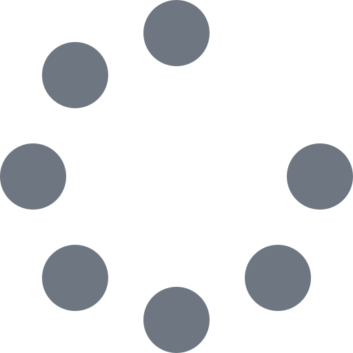 | `loading` | `fa7-solid:spinner` | | mockup |
|  | `empty` | `fa7-solid:inbox` | | mockup (empty list) |
|  | `locked` | `fa7-solid:lock` | | mockup (read-only record, no access) |
| 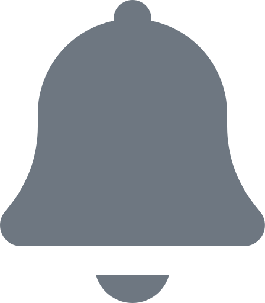 | `notifications` | `fa7-solid:bell` | | Crudit, mockup |

### User and header

| | Name | Font Awesome 7 (default) | RTL | Used in |
|---|---|---|---|---|
| 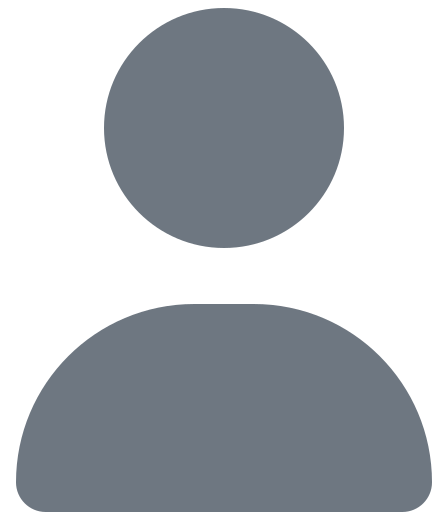 | `user` | `fa7-solid:user` | | Crudit (user menu, history), mockup |
|  | `logout` | `fa7-solid:right-from-bracket` | yes | Crudit (`sign-out-alt`), mockup |
|  | `impersonate` | `fa7-solid:user-secret` | | mockup (impersonation banner) |
|  | `language` | `fa7-solid:globe` | | mockup |
|  | `theme-light` | `fa7-solid:sun` | | mockup |
|  | `theme-dark` | `fa7-solid:moon` | | mockup |
|  | `theme-system` | `fa7-solid:desktop` | | mockup |
|  | `email` | `fa7-solid:envelope` | | Crudit (messages), mockup |

### History, dates and fields

| | Name | Font Awesome 7 (default) | RTL | Used in |
|---|---|---|---|---|
| 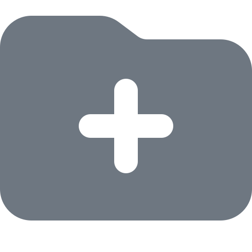 | `history-create` | `fa7-solid:folder-plus` | | Crudit (history) |
|  | `history-transition` | `fa7-solid:arrow-right-arrow-left` | | Crudit (`exchange`), mockup (workflow transition) |
|  | `time` | `fa7-regular:clock` | | Crudit (history) |
|  | `calendar` | `fa7-solid:calendar-days` | | mockup (period picker) |
|  | `repeat` | `fa7-solid:repeat` | | mockup (cron field) |
|  | `file` | `fa7-solid:file-lines` | | mockup (file upload) |
| 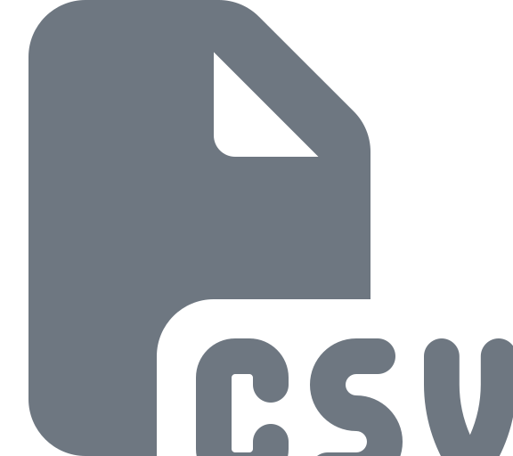 | `file-csv` | `fa7-solid:file-csv` | | mockup (export) |
| 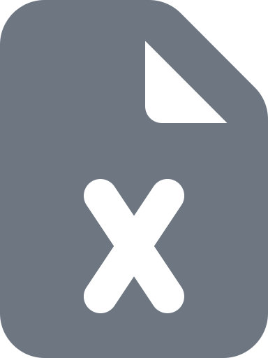 | `file-excel` | `fa7-solid:file-excel` | | mockup (export) |
|  | `file-pdf` | `fa7-solid:file-pdf` | | mockup (export) |

### Rich text editor

| | Name | Font Awesome 7 (default) | RTL | Used in |
|---|---|---|---|---|
|  | `bold` | `fa7-solid:bold` | | mockup |
|  | `italic` | `fa7-solid:italic` | | mockup |
| 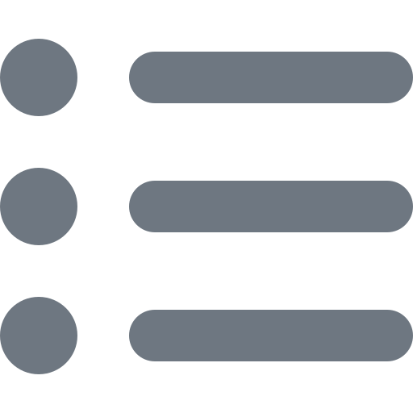 | `bulleted-list` | `fa7-solid:list-ul` | yes | mockup |
| 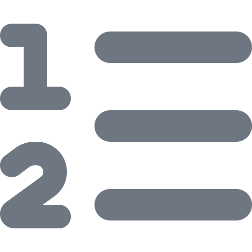 | `numbered-list` | `fa7-solid:list-ol` | yes | mockup |
|  | `quote` | `fa7-solid:quote-right` | | mockup |

`link` is in [Actions](#actions).

### Filter operators

| | Name | Font Awesome 7 (default) | RTL | Used in |
|---|---|---|---|---|
| 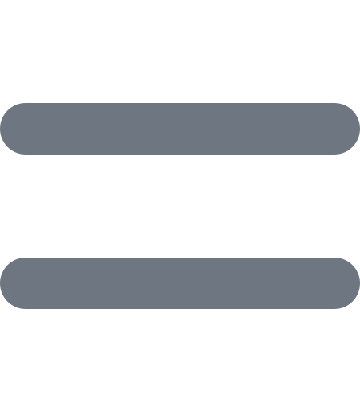 | `operator-equals` | `fa7-solid:equals` | | Crudit (filter types), mockup |
| 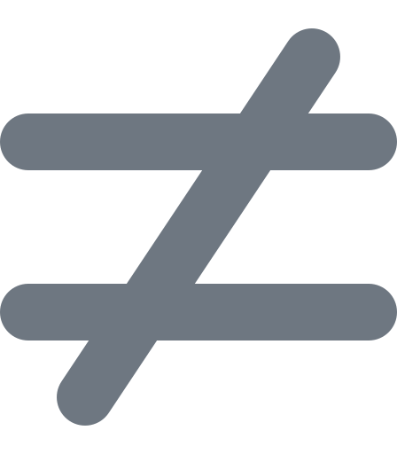 | `operator-not-equals` | `fa7-solid:not-equal` | | Crudit, mockup |
| 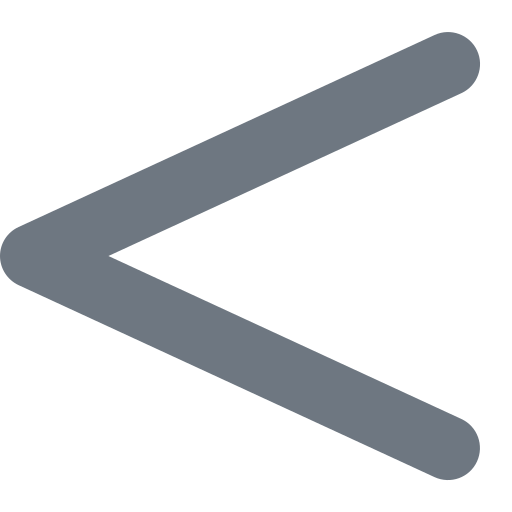 | `operator-less-than` | `fa7-solid:less-than` | | Crudit, mockup |
| 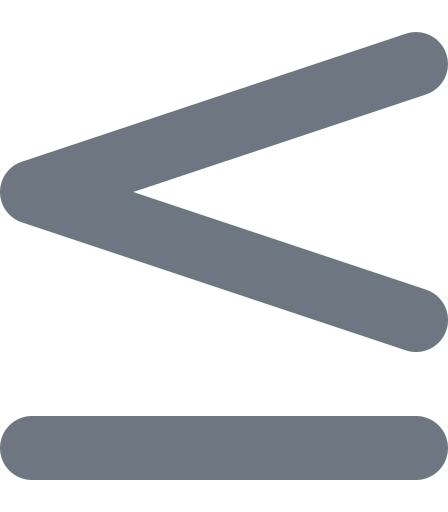 | `operator-less-or-equal` | `fa7-solid:less-than-equal` | | mockup |
| 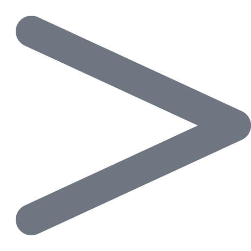 | `operator-greater-than` | `fa7-solid:greater-than` | | Crudit, mockup |
| 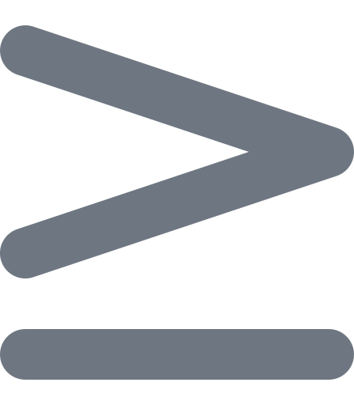 | `operator-greater-or-equal` | `fa7-solid:greater-than-equal` | | mockup |
| 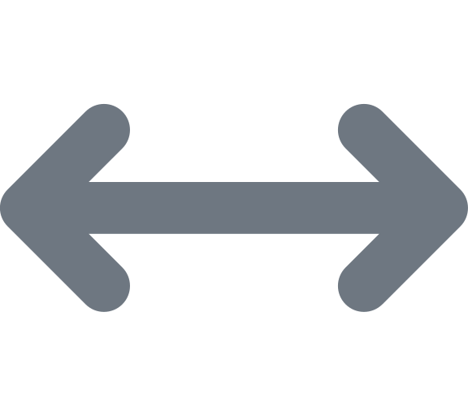 | `operator-between` | `fa7-solid:arrows-left-right` | | Crudit (`arrows-alt-h`), mockup |
| 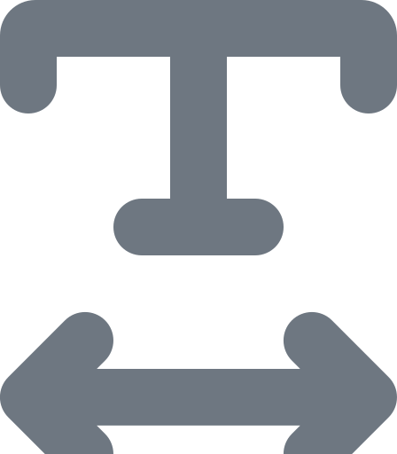 | `operator-contains` | `fa7-solid:text-width` | | Crudit, mockup |
|  | `operator-starts-with` | `fa7-regular:square-caret-right` | yes | Crudit (`caret-square-right`), mockup |
|  | `operator-ends-with` | `fa7-regular:square-caret-left` | yes | Crudit (`caret-square-left`), mockup |
| 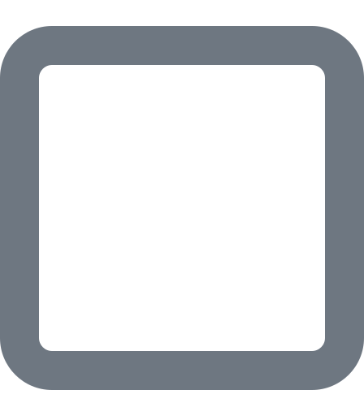 | `operator-empty` | `fa7-regular:square` | | Crudit, mockup |
| 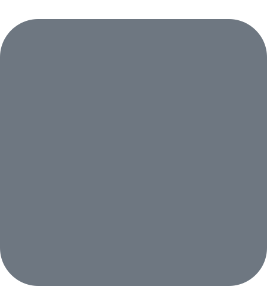 | `operator-not-empty` | `fa7-solid:square` | | Crudit, mockup |

### Dashboard

| | Name | Font Awesome 7 (default) | RTL | Used in |
|---|---|---|---|---|
|  | `trend-up` | `fa7-solid:arrow-trend-up` | yes | mockup (KPI variation) |
| 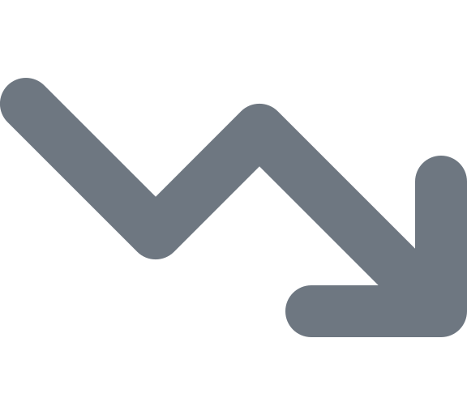 | `trend-down` | `fa7-solid:arrow-trend-down` | yes | mockup (KPI variation) |
| 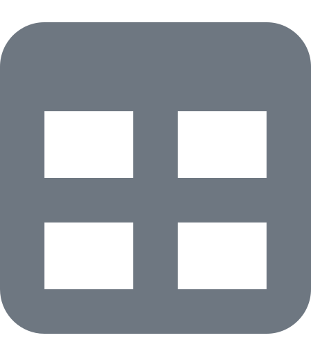 | `table` | `fa7-solid:table` | | mockup (show a chart as a table) |

The checklist widget uses `success`, `warning` and `error`.

## Not in the catalogue

- **Icons chosen by the projects** (menu entries, actions, tabs, search results: `building`, `truck`,
  `helmet-safety`…): the project passes their Iconify name to `ui_icon()` (`lucide:truck`); the Font Awesome classes
  (`fa fa-truck`, `fas fa-truck`) are no longer understood.
- **Crudit icons that disappear with the redesign**: the sample notifications of the `sb_admin` layout (`donate`,
  `file-alt`).
- **Mockup-only icons**: the mockup panel and the placeholder pages (`compass`, `layer-group`).
